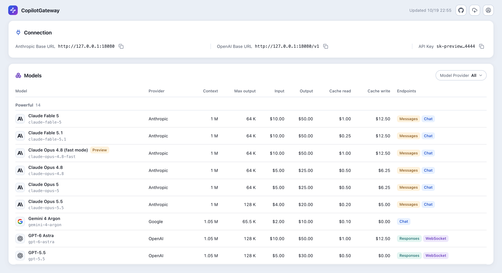
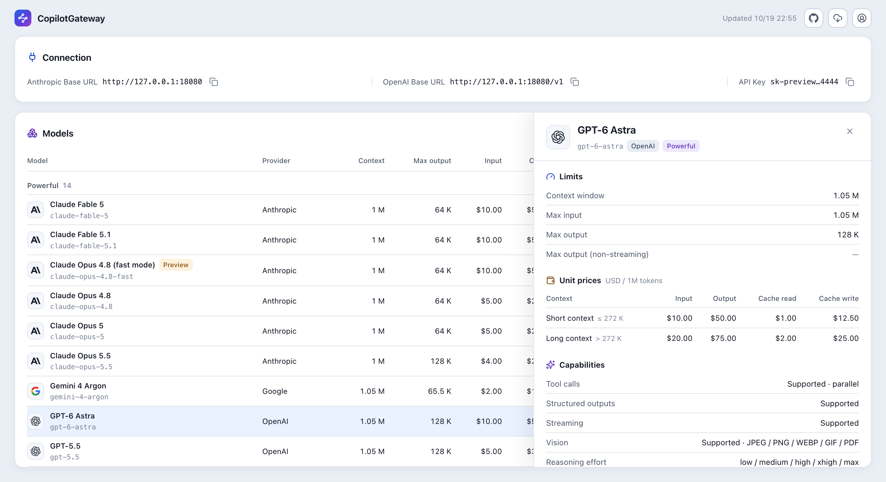

# CopilotGateway

A lightweight Go gateway/proxy that exposes GitHub Copilot as OpenAI-compatible and Anthropic-compatible API endpoints, with an optional web dashboard.

> Originally forked from [whtsky/copilot2api](https://github.com/whtsky/copilot2api), now maintained independently.

## Features

- **OpenAI API Compatible**: `/v1/chat/completions`, `/v1/responses`, `/v1/models`
- **Anthropic API Compatible**: `/v1/messages`
- **Models Cache**: 5-minute cache for `/v1/models` and Anthropic model capability lookups
- **1M Context Native**: Long-context limits come straight from the Copilot catalog on the base model ID
- **API Key Auth**: Required key for all requests — safe to deploy beyond localhost
- **Auto Authentication**: GitHub Device Flow OAuth; the Copilot token auto-refreshes and its API endpoint (Individual/Business/Enterprise) is detected automatically
- **In-Client Re-Authentication**: Shows the device-flow code in the client when GitHub authorization is lost, no restart needed
- **Streaming Support**: Automatic Responses item ID correlation to prevent duplicate streaming messages in Codex
- **Direct Passthrough**: Requests go straight to the matching upstream endpoint, with no cross-format translation
- **Web Dashboard**: Showing the live model catalog, enabled only when `COPILOTGW_WEB_*` are configured

## Security

- The gateway refuses to start without `COPILOTGW_API_KEY` or CLI flag `-api-key`.
- Every request must present a matching key, so it is safe to expose beyond localhost.
- Both of these are accepted in headers: `Authorization: Bearer <key>` or `x-api-key: <key>`.
- The `/health` endpoint is unauthenticated for load balancer probes.
- Credentials are stored in `~/.config/copilotgateway/credentials.json`.

## API Endpoints

| Endpoint | Method | Description |
|----------|--------|-------------|
| `/v1/chat/completions` | POST | OpenAI Chat Completions (streaming & non-streaming) |
| `/v1/responses` | POST | OpenAI Responses API |
| `/v1/messages` | POST | Anthropic Messages API (streaming & non-streaming) |
| `/v1/models` | GET | List available models (5min cache) |
| `/health` | GET | Health check (unauthenticated) |

## Web Dashboard

A login-protected page at `/` that shows the live model catalog: every callable model with a provider filter and per-model details (limits, capabilities, short- and long-context pricing), a Fetch button that pulls a fresh catalog from upstream, plus one-click copy of the Anthropic/OpenAI base URLs and gateway API keys.

**Disabled by default.** It only exists when **both** `COPILOTGW_WEB_USERNAME` and `COPILOTGW_WEB_PASSWORD` are set, otherwise all web paths return 404 and the gateway behaves as a pure API gateway, exactly as before.




## Quick Start

An API key is **required** for both ways — the gateway refuses to start without one. Any opaque string works; generate a strong one:

```bash
echo "sk-cgw-$(openssl rand -hex 32)"
```

On first run, the gateway asks for GitHub Device Flow authorization — visit the URL, enter the code, and you are done; credentials persist afterwards:

```
🔐 GitHub Authentication Required
Please visit: https://github.com/login/device
Enter code: XXXX-XXXX

Waiting for authorization...
✅ Authentication successful!
```

### Start with Docker

Set the key via `COPILOTGW_API_KEY`. Since the container runs detached, the first-run device-flow prompt appears in `docker logs -f copilotgateway`.

**1）Minimal** — API-only gateway:

```bash
docker run -d --name copilotgateway --restart unless-stopped \
  -p 127.0.0.1:7777:7777 \
  -e COPILOTGW_API_KEY=<key1,key2,...> \
  -v ~/.config/copilotgateway:/root/.config/copilotgateway \
  ghcr.io/heyjiqingcode/copilotgateway:1.2.0
```

**2）Full** — with the web dashboard enabled:

```bash
docker run -d --name copilotgateway --restart unless-stopped \
  -p 127.0.0.1:7777:7777 \
  -e COPILOTGW_API_KEY=<key1,key2,...> \
  -e COPILOTGW_WEB_USERNAME=admin \
  -e COPILOTGW_WEB_PASSWORD=<your_web_password> \
  -v ~/.config/copilotgateway:/root/.config/copilotgateway \
  ghcr.io/heyjiqingcode/copilotgateway:1.2.0
```

> See [Configuration](#configuration) for every available variable.

### Start with CLI

Download the archive for your OS/arch from [Releases](https://github.com/HeyJiqingCode/CopilotGateway/releases/latest), extract, and run — same behavior as Docker. Web credentials are env-only by design (no CLI flags), so secrets never show up in `ps` output.

Pass the key via `COPILOTGW_API_KEY` or the `-api-key` flag. The first-run device-flow prompt appears right in your terminal — credentials are saved to `~/.config/copilotgateway` (configurable via `-token-dir`), so later runs start without re-authenticating.

```bash
# example: macOS on Apple silicon
tar -xzf copilotgateway_*_darwin_arm64.tar.gz

# 1）API-only gateway
COPILOTGW_API_KEY=<your-secret-key> ./copilotgateway

# 2）with the web dashboard
COPILOTGW_API_KEY=<your-secret-key> \
COPILOTGW_WEB_USERNAME=admin \
COPILOTGW_WEB_PASSWORD=<your_web_password> \
./copilotgateway
```

> The CLI listens on `127.0.0.1:7777` by default; pass `-host 0.0.0.0` to expose it beyond localhost.\
> All flags are listed in [Configuration](#configuration).

### Lost GitHub Authorization

If GitHub rejects the stored token while the gateway is running (for example, the app authorization was revoked), the gateway clears it and starts a new device flow in the background. Every API request then fails with a non-retryable `403` whose message carries the sign-in link and code, so Claude Code and Codex show it directly:

```
GitHub Copilot authorization lost. Visit https://github.com/login/device and enter code ABCD-1234 (expires 12:30 UTC) to restore the gateway.
```

Enter the code and the gateway recovers without a restart. The same code is also written to the logs; if it expires unused, the next request starts a new one.

## Configuration

### CLI Flags

```
./copilotgateway [options]

  -host string          Server host (default "127.0.0.1")
  -port int             Server port (default 7777)
  -token-dir string     Token storage directory (default ~/.config/copilotgateway)
  -api-key string       Required API key(s), comma-separated (env: COPILOTGW_API_KEY)
  -responses-id-compat  Normalize drifting Responses output item IDs (default true)
  -model-routes string  JSON model route map for /v1/chat/completions and /v1/responses (env: COPILOTGW_MODEL_ROUTES)
  -debug                Enable debug logging
  -version              Show version and exit
```

> CLI flags take precedence over environment variables.

### Environment Variables

| Variable | Description | Default |
|----------|-------------|---------|
| `COPILOTGW_API_KEY` | Required API key(s) for clients, comma-separated | _none — required_ |
| `COPILOTGW_HOST` | Server host | `127.0.0.1` |
| `COPILOTGW_PORT` | Server port | `7777` |
| `COPILOTGW_TOKEN_DIR` | Token storage directory | `~/.config/copilotgateway` |
| `COPILOTGW_DEBUG` | Enable debug logging (`true`/`false`, `1`/`0`) | `false` |
| `COPILOTGW_RESPONSES_ID_COMPAT` | Normalize drifting Responses output item IDs; see [streaming compatibility](#streaming-compatibility) | `true` |
| `COPILOTGW_MODEL_ROUTES` | JSON map rewriting the requested model on `/v1/chat/completions` and `/v1/responses`, e.g. `{"codex-auto-review":"gpt-5.6-luna"}` for Codex automatic approval review, whose pseudo-model Copilot rejects | _unset — no routes_ |
| `COPILOTGW_EDITOR_VERSION` | Spoofed editor version header | `vscode/1.142.0` |
| `COPILOTGW_PLUGIN_VERSION` | Spoofed plugin version header | `copilot-chat/0.70.0` |
| `COPILOTGW_CHAT_USER_AGENT` | Spoofed Copilot Chat User-Agent | `GitHubCopilotChat/0.70.0` |
| `COPILOTGW_API_VERSION` | GitHub Copilot API version header | `2026-06-01` |
| `COPILOTGW_WEB_USERNAME` | Web dashboard login username (dashboard enabled only when username & password are both set) | _unset — dashboard disabled_ |
| `COPILOTGW_WEB_PASSWORD` | Web dashboard login password | _unset — dashboard disabled_ |
| `COPILOTGW_WEB_SESSION_HOURS` | Web dashboard session lifetime (hours) | `24` |

## Context Window

Newer models on Copilot (e.g. Opus 4.6/4.7/4.8, Sonnet 4.6/5, gpt-5.5/5.6) expose their context limits through the Copilot `/models` catalog on the base model ID. There are no `-1m` model variants to append; send the model ID as-is.

The `/v1/models` gateway uses VS Code-style model metadata headers (`model-access`) and Copilot API version `2026-06-01`, matching the model catalog shape VS Code currently uses for long-context metadata. If VS Code shows a larger context window than this gateway, check that `COPILOTGW_API_VERSION` is not overridden to an older value.

## Streaming compatibility

**Enabled by default** for `/v1/responses` streaming requests with both CLI and Docker startup. No extra flag is needed.

Some Copilot streams change an output item's ID between events, which can cause duplicate streaming messages in Codex. The gateway correlates items by `output_index` within each request and corrects IDs only when drift is detected, covering added, delta, done and final `response.output` events. Normal streams pass through unchanged, text is never deduplicated, and events continue streaming as they arrive.

The complete final `encrypted_content`, tool `call_id` and upstream `response.id` are preserved. Requests and `previous_response_id` are forwarded unchanged; this fix does not add upstream support for `previous_response_id`.

To **disable only for troubleshooting**, set `COPILOTGW_RESPONSES_ID_COMPAT=false` or pass `-responses-id-compat=false` when starting the gateway. An explicit CLI flag takes precedence over the environment variable. Apply the setting by restarting the gateway or recreating the container with the updated configuration.

Disabling restores the upstream ID behavior for new streams. Saved sessions are not rewritten, and disabling or restarting requires no session migration or ID-map recovery: associations exist only for the current stream. A restart can still interrupt requests in progress.

## Usage

### Claude Code

Add to `~/.claude/settings.json`:

```json
{
  "env": {
    "ANTHROPIC_BASE_URL": "http://127.0.0.1:7777",
    "ANTHROPIC_AUTH_TOKEN": "your-secret-key",
    "ANTHROPIC_DEFAULT_MODEL": "claude-opus-5-5",
    "ANTHROPIC_DEFAULT_FABLE_MODEL": "claude-fable-5-1",
    "ANTHROPIC_DEFAULT_FABLE_MODEL_NAME": "Claude Fable 5.1",
    "ANTHROPIC_DEFAULT_FABLE_MODEL_DESCRIPTION": "Claude Fable 5.1 routed through a Github Copilot custom endpoint",
    "ANTHROPIC_DEFAULT_OPUS_MODEL": "claude-opus-5-5",
    "ANTHROPIC_DEFAULT_OPUS_MODEL_NAME": "Claude Opus 5.5",
    "ANTHROPIC_DEFAULT_OPUS_MODEL_DESCRIPTION": "Claude Opus 5.5 routed through a Github Copilot custom endpoint",
    "ANTHROPIC_DEFAULT_SONNET_MODEL": "claude-sonnet-5-5",
    "ANTHROPIC_DEFAULT_SONNET_MODEL_NAME": "Claude Sonnet 5.5",
    "ANTHROPIC_DEFAULT_SONNET_MODEL_DESCRIPTION": "Claude Sonnet 5.5 routed through a Github Copilot custom endpoint",
    "ANTHROPIC_DEFAULT_HAIKU_MODEL": "claude-haiku-5-5",
    "ANTHROPIC_DEFAULT_HAIKU_MODEL_NAME": "Claude Haiku 5.5",
    "ANTHROPIC_DEFAULT_HAIKU_MODEL_DESCRIPTION": "Claude Haiku 5.5 routed through a Github Copilot custom endpoint",
    "CLAUDE_CODE_SUBAGENT_MODEL": "claude-opus-5-5"
  },
  "permissions": {
    "deny": [
      "WebSearch"
    ]
  }
}
```

### Codex

Add to `~/.codex/config.toml`. With `env_key`, Codex reads the gateway key from an environment variable instead of storing it in the config file — export it before launching: `export COPILOTGATEWAY_API_KEY=<your-secret-key>`.

```toml
model = "gpt-6.1-sol"
model_provider = "copilotgateway"
model_reasoning_effort = "high"
model_context_window = 1050000
web_search = "live"

[model_providers.copilotgateway]
name = "copilotgateway"
base_url = "http://127.0.0.1:7777/v1"
wire_api = "responses"
env_key = "COPILOTGATEWAY_API_KEY"
```
